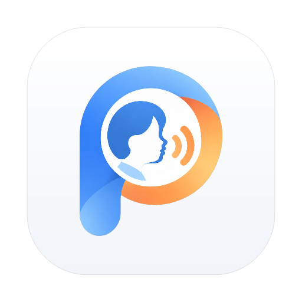
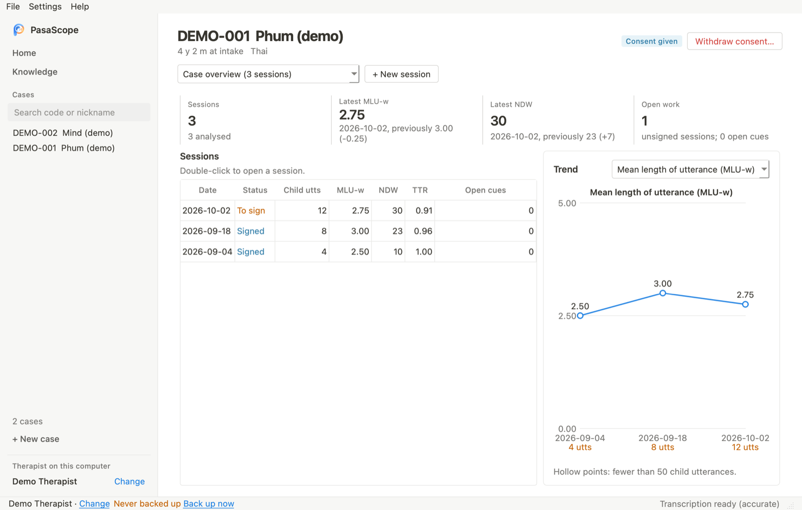
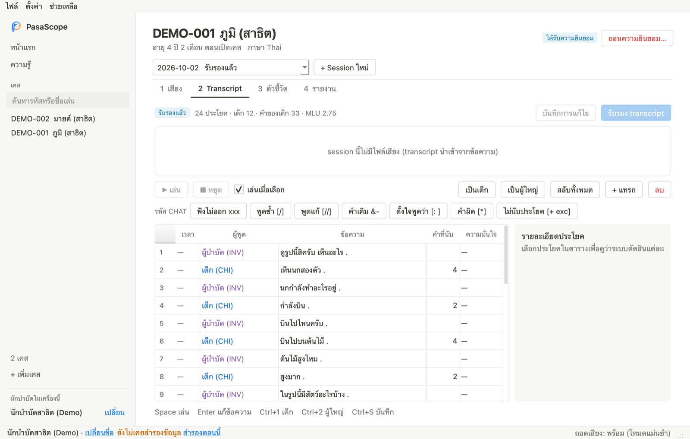
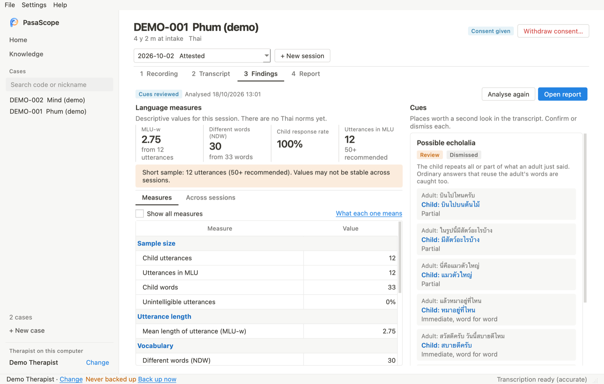
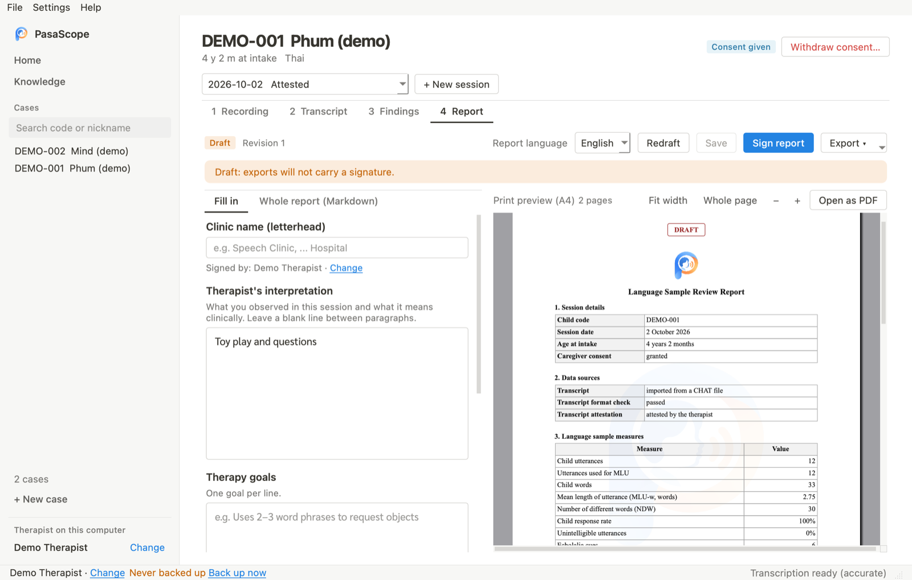
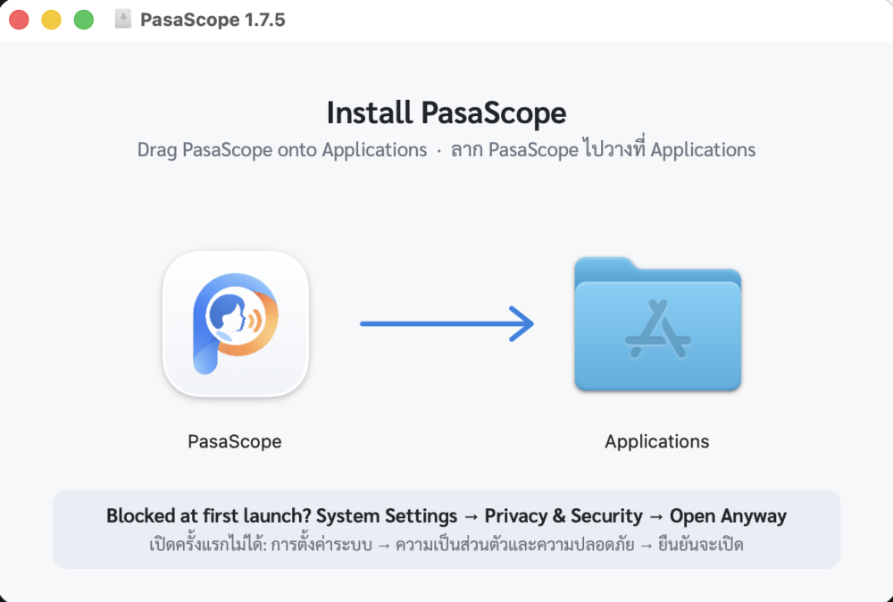

<p align="center">
  
</p>

<h1 align="center">PasaScope</h1>

<p align="center">
  Transcribe and measure a child's language sample, on your own computer.<br>
  <sub>A desktop app for Mac and Windows, for speech-language therapists working with Thai-speaking children · <a href="#ภาษาไทย">ภาษาไทย</a></sub>
</p>

<p align="center">
  <a href="https://github.com/monai86/pasascope/releases/latest"><b>⬇️ Download</b></a>
  &nbsp;·&nbsp;
  <a href="#install">Install</a>
  &nbsp;·&nbsp;
  <a href="#first-use">First use</a>
  &nbsp;·&nbsp;
  <a href="https://monai86.github.io/pasascope/">Website</a>
</p>

<p align="center">
  
</p>

## What PasaScope does

Record a therapy session, or open a recording, and PasaScope:

1. **Drafts a Thai transcript** in CHAT format with the child's and the adults' turns separated, for you to check line by line and attest.
2. **Computes language-sample measures** from the attested transcript: mean length of utterance in words (MLU-w), number of different words (NDW, NDW-100), MATTR, VOCD-D, how often the child answers an adult, and more. Each measure explains what it is, how it helps and what to watch for.
3. **Points to lines worth a second look**, such as possible echolalia, with the adult's line, the child's line and the reason. You confirm or dismiss each one.
4. **Drafts an A4 report** in English or Thai with a live print preview, for you to edit, sign and export as PDF.
5. **Shows each child's trend** across sessions.

Everything runs on your computer: no account, no server, and recordings never leave it.

> [!IMPORTANT]
> PasaScope **does not diagnose**. It does not say whether a child is autistic. Its measures are descriptive and have no Thai norms yet, and interpretation is the therapist's.
> Automatic transcripts can be wrong: check every line against the recording before attesting.

<table>
  <tr>
    <td width="50%"><br><b>Transcript</b>: correct text and speakers, add CHAT codes, then attest.</td>
    <td width="50%"><br><b>Findings</b>: the 11 main measures, and cues with examples from the transcript.</td>
  </tr>
  <tr>
    <td width="50%"><br><b>Report</b>: write the interpretation, goals and recommendations and see the A4 page as you type.</td>
    <td width="50%"><br><b>Case overview</b>: every session of a child, with a trend chart.</td>
  </tr>
</table>

<sub>Screens show demonstration data written for the purpose, not a real child.</sub>

### How accurate is it?

Measured on the current version (details in [`reports/metrics/EVALUATION_SUMMARY.md`](./reports/metrics/EVALUATION_SUMMARY.md)):

- **Measures**: on 1,961 English TalkBank transcripts, MLU-w, NDW-100, MATTR-50 and VOCD-D agree with CLAN, the reference tool for CHAT transcripts (ICC ≥ 0.9997; 94–96% identical values).
- **Transcription**: on Thai read speech the character error rate is 6.5% in accurate mode and 19.2% in fast mode. On toddlers' play it is much higher, which is why every transcript is checked by the therapist before any measure is computed.
- **Child or adult**: 87% of utterances are attributed to the right speaker on recordings of children aged 2½ to 5½.

<a id="install"></a>

## Download and install

**You need**
- A Mac with Apple silicon (M1 or later) on macOS 12 or later (Apple menu → About This Mac → Chip; Intel Macs are not supported yet), **or** a PC with 64-bit Windows 10 or 11
- About 5 GB free: the app is 1.5 GB, and the speech models it downloads on first use about 2 GB.

The steps below are for the Mac; see [Windows](#windows) for a PC.

### 1. Download

Open the **[latest release](https://github.com/monai86/pasascope/releases/latest)**, scroll to **Assets** and click `PasaScope-x.y.z.dmg` (about 390 MB). The `.sha256` file beside it checks the download and is optional.

### 2. Install

Open the `.dmg` and drag **PasaScope** onto **Applications**.

<p align="center"></p>

Then close the window and eject PasaScope (⏏) in the Finder sidebar.

### 3. Open it the first time

PasaScope is not notarised by Apple yet, so macOS blocks the first launch. Allow it once:

1. Open **PasaScope** from Applications. When macOS warns you, click **Done**.
2. Go to **System Settings → Privacy & Security** and scroll to **Security**.
3. Next to the message about PasaScope, click **Open Anyway** and enter your password.

On macOS 12–14 you can instead right-click PasaScope and choose **Open**.

### 4. First setup

1. **Enter your name.** It is used to attest transcripts and sign reports. Change it any time with **Change** in the sidebar.
2. **Download the speech models**: **Settings → Download speech models…**, about 1.5 GB, once. Every file is checked by SHA-256.
3. Optional: the **clinic name** printed on reports, in **Settings → Clinic name on reports…**

The window works like a code editor: cases and their sessions in the side bar, each session in its own tab, and a command palette (**Ctrl/Cmd+Shift+P**; **Ctrl/Cmd+P** opens a case or session by typing). The interface is in English; switch to Thai with **Settings → Language**. It follows the computer's light or dark appearance; choose one yourself in **Settings → Appearance**. Pages fade in briefly unless the computer's Reduce motion is on (**Settings → Motion**).

<a id="windows"></a>

### Windows

1. From the [latest release](https://github.com/monai86/pasascope/releases/latest), download `PasaScope-x.y.z-windows-x64-setup.exe` (about 310 MB).
2. Open it. The installer is not signed yet, so Windows SmartScreen may say it protected your PC: click **More info**, then **Run anyway**.
3. Follow the installer. It installs for your user only, without administrator rights, and adds PasaScope to the Start menu (and the desktop, if you leave that ticked).
4. First setup is the same as on a Mac: your name, then **Settings → Download speech models…**

Updates work the same way: PasaScope downloads and checks the new installer, closes, installs it without the wizard and opens again. Your data is in `%APPDATA%\PasaScope` and is kept on update and uninstall.

<a id="first-use"></a>

## First use

1. **Add a case** (**+ New case**): the child's code, age and nickname. Then **record the caregiver's consent**; sessions can only be created after it.
2. **Create a session** and work through the four tabs from left to right:
   - **Recording**: record in the app or choose an audio file, then transcribe. You can also import an existing transcript (`.cha`).
   - **Transcript**: listen line by line, correct the text and speakers, and click **Attest transcript**.
   - **Findings**: read the main measures and confirm or dismiss each cue. Double-click a measure to read what it means.
   - **Report**: fill in the interpretation, goals and recommendations, check the preview, then **Sign report** and **Export** a PDF.
3. **Home** lists the work waiting across all cases. Double-click a line to carry on.
4. **Right-click a case** in the sidebar (or use **⋯** next to its name, or the **Case** menu) to edit its details, record or withdraw consent, or delete it. Deleting asks you to type the child's code, removes the case's sessions, recordings, transcripts and reports from this computer, and keeps a note in the audit log. Right-click a session in the case overview to delete just that session.

**Help → Knowledge** (F1) explains every measure and shows the age charts.

## Updates

PasaScope checks for a new version once a day (you can switch this off), or use **Help → Check for updates…**. When there is one, it offers to back up your data, downloads the new version, checks its SHA-256 and installs it over this copy: choose **Restart now** and PasaScope reopens as the new version, or **Later** to install it when you next quit. Nothing needs uninstalling, and your cases are kept apart from the app, so updating does not remove them.

## Your data

- Cases, recordings, transcripts and reports stay on this computer: `~/Library/Application Support/PasaScope` on a Mac, `%APPDATA%\PasaScope` on Windows (**File → Open data folder**).
- **File → Back up…** writes everything to one file; **File → Restore from backup…** brings it back. Home reminds you when a backup is due.
- Every change is recorded in an audit log that cannot be edited or deleted.
- The internet is used only to download the speech models and to check for updates.

## Problems and suggestions

Open an issue on [GitHub Issues](https://github.com/monai86/pasascope/issues). Do not attach recordings, names or anything that identifies a child.

PasaScope is an educational and research prototype from the Department of Medical Technology, Mahidol University. It has not been clinically validated with Thai children.

<a id="ภาษาไทย"></a>

## ภาษาไทย

PasaScope เป็นโปรแกรมช่วยนักแก้ไขการพูด ถอดเสียงภาษาไทยเป็น transcript รูปแบบ CHAT (แยกเสียงเด็กกับผู้ใหญ่ให้) ให้นักบำบัดตรวจแก้และรับรอง แล้วคำนวณตัวชี้วัดจากตัวอย่างภาษา เช่น MLU-w, NDW และอัตราที่เด็กตอบต่อจากผู้ใหญ่ ชี้จุดที่ควรกลับไปดู เช่น การพูดตาม และร่างรายงาน PDF ภาษาไทยหรืออังกฤษให้แก้และลงนาม ทุกอย่างทำงานบนเครื่อง ไม่มีบัญชีผู้ใช้ ไม่มีเซิร์ฟเวอร์ **และไม่ใช่เครื่องมือวินิจฉัย**

**ติดตั้งบน Mac** (Mac ชิป Apple, macOS 12 ขึ้นไป, พื้นที่ว่างประมาณ 5 GB)

1. ดาวน์โหลด `PasaScope-x.y.z.dmg` จาก[หน้าดาวน์โหลดรุ่นล่าสุด](https://github.com/monai86/pasascope/releases/latest) (หัวข้อ Assets)
2. เปิดไฟล์ แล้วลาก PasaScope ไปวางบน Applications
3. เปิดครั้งแรก macOS จะปิดกั้นเพราะแอปยังไม่ได้ลงทะเบียนกับ Apple: กด **เสร็จสิ้น** แล้วไปที่ **การตั้งค่าระบบ → ความเป็นส่วนตัวและความปลอดภัย** กด **ยืนยันจะเปิด** และใส่รหัสผ่าน (macOS 12–14 คลิกขวาแล้วเลือก **เปิด** ได้เลย)
4. ใส่ชื่อนักบำบัด แล้วไปที่ **Settings → Download speech models…** (ประมาณ 1.5 GB ทำครั้งเดียว) เปลี่ยนหน้าจอเป็นภาษาไทยได้ที่ **Settings → Language / ภาษา** หน้าจอสว่างหรือมืดตามเครื่อง เลือกเองได้ที่ **ตั้งค่า → ธีม** ภาพเคลื่อนไหวปิดเองถ้าเครื่องเปิด "ลดการเคลื่อนไหว" ไว้ (**ตั้งค่า → การเคลื่อนไหว**)

**ติดตั้งบน Windows** (Windows 10 หรือ 11 แบบ 64 บิต): ดาวน์โหลด `PasaScope-x.y.z-windows-x64-setup.exe` จากหน้าเดียวกัน เปิดไฟล์ ถ้า Windows SmartScreen แจ้งเตือน ให้กด **More info** แล้ว **Run anyway** จากนั้นทำตามตัวติดตั้ง (ไม่ต้องใช้สิทธิ์ผู้ดูแลระบบ)

**เริ่มใช้งาน:** เพิ่มเคสและบันทึกความยินยอมของผู้ปกครอง → สร้าง session → ทำตามแท็บ เสียง → Transcript → ตัวชี้วัด → รายงาน

**อัปเดต:** ช่วยเหลือ → ตรวจหาอัปเดต… โปรแกรมสำรองข้อมูลก่อน แล้วติดตั้งรุ่นใหม่ทับรุ่นเดิมให้เอง กด "เปิดใหม่ตอนนี้" แล้วโปรแกรมจะเปิดขึ้นเป็นรุ่นใหม่ ไม่ต้องลบโปรแกรมเดิม ข้อมูลเคสเก็บแยกจากตัวโปรแกรมจึงไม่หาย

**แจ้งปัญหา:** [GitHub Issues](https://github.com/monai86/pasascope/issues) ห้ามแนบเสียง ชื่อ หรือข้อมูลที่ระบุตัวเด็ก

---

# For developers and researchers

PasaScope is a research prototype that turns recordings and CHAT (`.cha`)
transcripts of children's speech into descriptive language-sample measures and
a draft report for a speech-language therapist to review. It is
**not a diagnostic tool** and has no Thai clinical validation.

- Project version: `v1.8.0`
- Main deliverable (and the term paper's subject): the PySide6 desktop program
  in `packages/desktop/`. It runs on one computer with SQLite and no server.
- Rules every change must follow: [`docs/PROJECT_SOURCE_OF_TRUTH.md`](./docs/PROJECT_SOURCE_OF_TRUTH.md).
  Folder map: [`docs/REPO_STRUCTURE.md`](./docs/REPO_STRUCTURE.md).
- The paused web app (Next.js) and its deploy setup were removed from the
  working tree on 2026-10-23. They are kept at git tag `web-app-final`.

## Run from source

```bash
python3.12 -m venv .venv312
source .venv312/bin/activate
pip install -r requirements.txt -r apps/api/requirements.txt -r requirements-desktop.txt
./run_gui.sh            # or: ./run_gui.sh --demo  (seeded demo data)
```

Data lives in `~/Library/Application Support/PasaScope` on macOS (override with
`PASASCOPE_DESKTOP_HOME`). The Thai Whisper model is downloaded on first use and
checked by SHA-256; to build it locally see `models/README.md` and
`scripts/convert_thai_whisper.sh`. Full setup: [`DEVELOPER_SETUP.md`](./DEVELOPER_SETUP.md).

## How the code fits together

```
packages/desktop/ui    PySide6 windows (workbench, session tabs, report preview)
packages/desktop/core  DesktopService: consent checks, audit log, SQLite workspace
apps/api/app/services  shared service layer (transcripts, features, reports, safety checks)
src/audio_pipeline     Whisper ASR, VAD, child/adult speaker split, CHAT output
src/clinical_speech    Thai LSA rules (thai_lsa.py), CHAT export, feature extraction
packages/features      transcript, turn-taking and acoustic measures
packages/cha           CHAT parser and the Thai word list
```

The desktop program calls `apps/api/app/services` in-process; it has no
formulas of its own. `apps/api` holds only that service layer, its database
models and repository, and their tests; the web API routes are gone.

## Building and releasing

- macOS: `python scripts/build_macos_dmg.py` → `dist/PasaScope-<version>.dmg`
- Windows: `.github/workflows/desktop-windows.yml` runs `scripts/build_windows.py`
- Release steps, signing and in-app updates: [`docs/DESKTOP_RELEASE.md`](./docs/DESKTOP_RELEASE.md)
- Download page: `site/` (GitHub Pages, `.github/workflows/pages.yml`)

## Evaluation (numbers used in the term paper)

All results are in `reports/metrics/`, summarised in
[`reports/metrics/EVALUATION_SUMMARY.md`](./reports/metrics/EVALUATION_SUMMARY.md).
Each comes from a script in `scripts/`:

| Result | Script |
|---|---|
| Thai ASR accuracy (own and public sets) | `evaluate_thai_asr.py`, `evaluate_thai_asr_public.py` |
| Core measures vs CLAN KIDEVAL (1,961 transcripts) | `evaluate_core_measures_clan.py`, `run_clan_batch.py`, `parse_clan_kideval.py` |
| Child/adult speaker attribution | `evaluate_speaker_attribution.py`, `evaluate_clinic_speaker_model.py` |
| Utterance boundaries, turn taking, echolalia cue | `train_utterance_boundaries.py`, `evaluate_turn_taking.py`, `evaluate_echolalia_cue.py` |
| Thai word segmentation | `evaluate_thai_word_segmentation.py` |
| End to end | `evaluate_end_to_end.py`, `build_synthetic_thai_dialogues.py` |
| Transcript ASD screening replication | `replicate_transcript_asd_screening.py` |

Evaluation audio and gold transcripts: [`data/evaluation/README.md`](./data/evaluation/README.md).
TalkBank downloads: [`docs/TALKBANK_DOWNLOAD_RUNBOOK.md`](./docs/TALKBANK_DOWNLOAD_RUNBOOK.md).
Earlier ML work (reference-evidence model, Gate 1) is in `reports/ml/`,
`packages/ml/`, `scripts/ml/` and [`docs/ML_DECISION_SUPPORT_MODEL_CARD.md`](./docs/ML_DECISION_SUPPORT_MODEL_CARD.md).

## Data sources

Public TalkBank/ASDBank transcripts are under `data/` (Eigsti, Nadig,
NYU-Emerson, Flusberg, Rollins, QuigleyMcNally) with manifests in
`data/manifests/`. Raw corpus mirrors and audio stay out of git
(ADR [`0003`](./docs/adr/0003-keep-talkbank-raw-mirror-out-of-git.md)).

## Tests

```bash
bash scripts/check_project.sh          # consistency, secret scan, all Python tests
PYTHONPATH=apps/api:src pytest tests/test_desktop*.py -q   # desktop only
PYTHONPATH=apps/api:src pytest -m "not audio" -q           # what CI runs
```

On macOS run the Qt tests (`tests/test_desktop*.py`) in their own pytest
process, as `check_project.sh` does.

## Key documents

| Document | Purpose |
|---|---|
| [`SCOPE_AND_DELIVERABLES.md`](./SCOPE_AND_DELIVERABLES.md) | What the term paper presents and what is out of scope |
| [`docs/TERM_PAPER_MAPPING.md`](./docs/TERM_PAPER_MAPPING.md) | Paper sections mapped to code and evidence |
| [`docs/FEATURE_GUIDE.md`](./docs/FEATURE_GUIDE.md) | Every measure, how it is counted, and its evidence |
| [`docs/REPORT_LAYOUT.md`](./docs/REPORT_LAYOUT.md) | Report and PDF layout |
| [`docs/AUDIO_PIPELINE.md`](./docs/AUDIO_PIPELINE.md) | Recording → transcript draft |
| [`docs/PILOT_USABILITY_PROTOCOL.md`](./docs/PILOT_USABILITY_PROTOCOL.md) | Therapist usability test (not run yet) |
| [`KNOWN_LIMITATIONS.md`](./KNOWN_LIMITATIONS.md) | Limitations |
| [`docs/REFERENCES.md`](./docs/REFERENCES.md) | Bibliography |
| [`CHANGELOG.md`](./CHANGELOG.md) | Version history |
