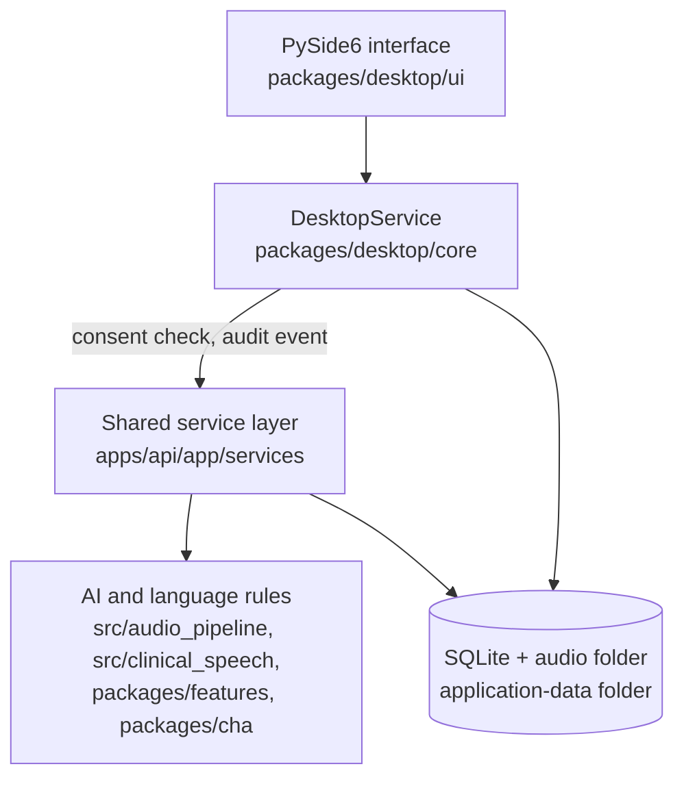

# PasaScope Architecture

Status: v1.8.0, desktop program.

PasaScope is one program on one computer. It has four layers that run in the
same process (term paper Figure 4.1):

## Layers

- **Interface** (`packages/desktop/ui`): windows, session tabs, waveform
  review, measures, report preview and PDF. Long work runs on a background
  thread (`TaskRunner`) with a progress window. No clinical logic here.
- **DesktopService** (`packages/desktop/core`): the only door from the
  interface to the data. One mixin per part of the workflow in
  `core/workflow/` (cases, recordings, transcripts, findings, reports,
  settings, clinic speaker model, maintenance). It checks consent and writes
  audit events, then calls the service layer. It has no formulas of its own.
- **Service layer** (`apps/api/app/services`): transcripts and attestation,
  feature extraction, review cues, report drafting (`template_th`,
  `template_clinic_en`), the report safety check, consent and audit rules. The
  same code once served the web app; its FastAPI routes remain in `apps/api`
  and are covered by `apps/api/tests`.
- **Engine**: Whisper transcription, voice activity detection, child/adult
  speaker split, utterance boundaries, CHAT output (`src/audio_pipeline`);
  Thai language-sample rules (`src/clinical_speech/thai_lsa.py`); measures
  (`packages/features`); CHAT parsing and the Thai word list (`packages/cha`).

## Boundaries

- The interface never writes to the database directly.
- Every measure comes from one implementation; the desktop program must not
  add a second formula.
- Every automated output (transcript draft, measures, cues, report draft) is a
  draft until the therapist reviews it.
- No network calls except model downloads and update checks, both verified by
  SHA-256.
